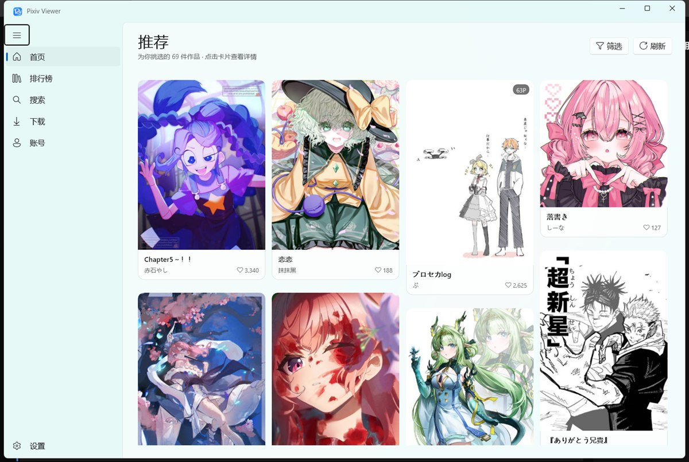
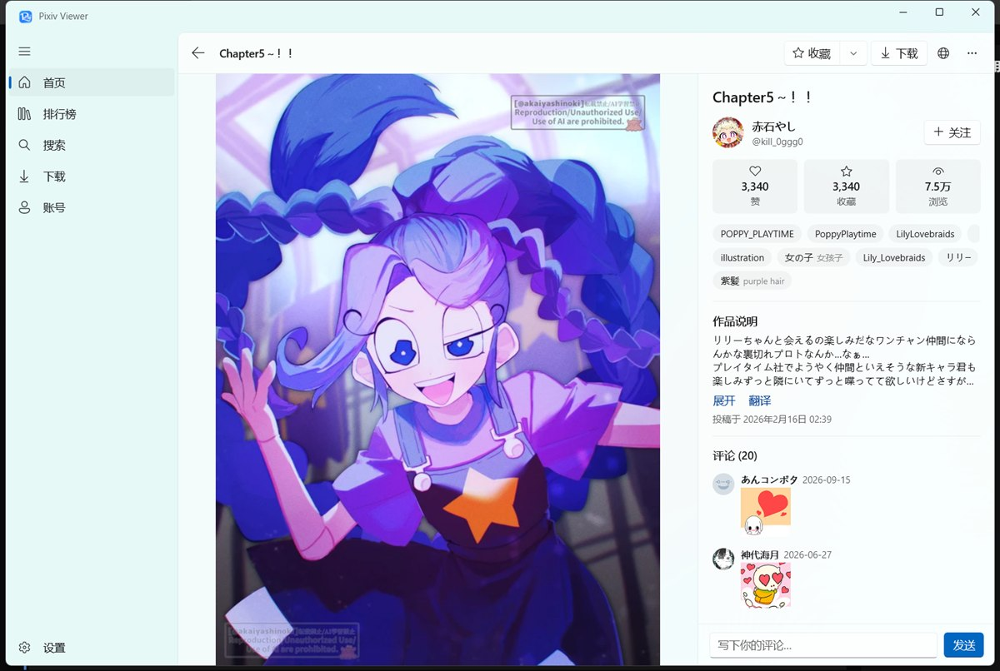
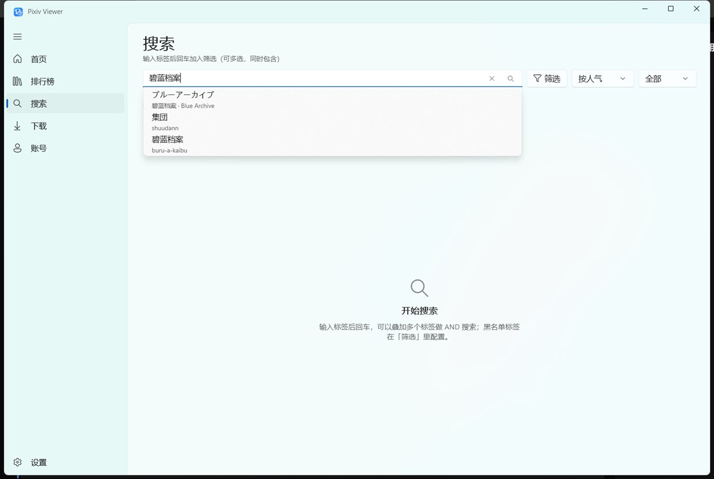
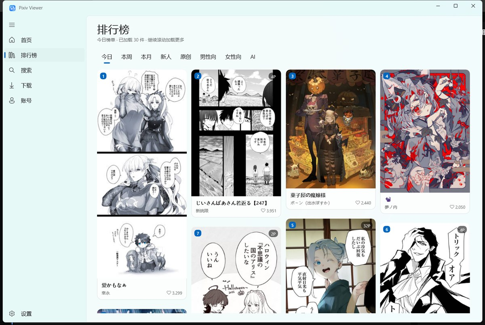

# Pixiv Viewer WinUI

一个用 **WinUI 3** 写的第三方 Pixiv 桌面客户端，界面全中文，Fluent / Mica 风格。

> 非官方客户端，仅供学习与技术交流，请遵守 Pixiv 用户协议。

  
  
  
  

---

## 功能

### 浏览

- 首页推荐，可按作品类别（插画 / 漫画 / 动图）筛选
- 排行榜：今日、本周、本月、新人、原创、男性向、女性向、AI、R-18、R-18G
- 搜索：多标签同时包含、按人气或最新排序、黑名单过滤
- 瀑布流布局，滚动时只渲染可见区域，长列表也不卡
- 可开关 R-18 / R-18G / AI 作品的显示

### 作品详情

- 多 P 作品逐页浏览，先出大图再渐进替换为原图
- 滚轮以鼠标位置为中心缩放、拖拽平移
- 全屏查看，支持 F11 / Esc / 方向键操作
- 作品说明里的 Pixiv 链接可直接点击跳转
- 右键另存为原图、查看详情、切换全屏

### 标签

- 标签显示中日双语：原文为主，官方译名以浅色小字跟在后面
- 搜索和筛选都支持**输入中文或英文**，自动补全成日文原文标签
- 候选里同时显示中文和英文译名，不用自己记日文写法
- 点标签进入标签详情页，标题同样是双语

### 账号与收藏

- 支持账号密码网页登录，登录状态自动续期
- 收藏 / 私密收藏 / 关注，右键菜单会按当前状态显示「收藏」或「取消收藏」
- 已收藏的作品在卡片右下角有金色标记
- 登录凭证加密保存在本机，只有当前 Windows 账户能读取

### 评论

- 读取作品评论并分页加载
- 印章、表情贴纸按 Pixiv 官方样式显示成图片，不是文字
- 单条评论可一键翻译 / 显示原文

### 翻译

- 作品说明、评论都支持「翻译 / 显示原文」切换
- 优先使用 B 站 Index-Translate 免费接口，失败自动回退 MyMemory

### 下载

- 一键下载原图，支持批量任务队列
- 下载任务持久化，关掉程序再打开还在
- 可查看下载进度、打开下载文件夹、删除任务与文件

### 其它

- **连接方式双通道**：自建 API 反代优先，反代不可用时自动切「域前置直连」，不需要任何服务器
- 域前置直连：把 Pixiv 域名解析到固定 IP，TLS 仍按原域名握手（SNI / 证书校验不变），IP 可在设置里改
- 主题：跟随系统 / 浅色 / 深色
- 黑名单标签过滤
- 缓存占用查看与一键清理
- 「关于」页可查看版本与完整更新日志

---

## 下载安装

从 [Releases](https://github.com/TheMyceliumOfAntan/PixivViewer.WinUI/releases) 下载 `PixivViewer-Setup-<版本>-x64.exe`，双击安装。

> **两种接口方式，任选其一**
> - **域前置直连（默认，免服务器）**：程序内置 Pixiv 官方域名的可用 IP，开箱即用；IP 失效时可在「设置 → 服务地址」里改。
> - **自建 API 反代**：填自己的服务地址，速度更稳；服务端代码与一键部署入口在 [TheMyceliumOfAntan/pixiv-proxy-api](https://github.com/TheMyceliumOfAntan/pixiv-proxy-api)。
>
> 两者可同时启用：反代连不上 / 超时 / 5xx 时会自动切换到域前置。

首次启动流程：

1. 打开程序会自动进入「设置 → 服务地址」
2. 选择「域前置直连」直接保存即可；或选「自建 API 反代」并填入地址（例如 `https://your-api.example.com`）
3. 到「设置 → 账号」登录，之后就能正常使用了

- 已装旧版本时**直接装新版即可覆盖升级**，不需要先卸载
- 服务地址、登录状态、设置、下载记录保存在 `%LOCALAPPDATA%\PixivViewer`，升级和卸载都不会丢
- 卸载时会单独询问是否一并删除这些本地数据

也提供免安装版压缩包：解压后双击 `Pixiv Viewer WinUI.exe` 即可运行，不需要 MSIX、不需要签名。

### 系统要求

| 项 | 要求 |
| --- | --- |
| 系统 | Windows 10 1809（17763）及以上 / Windows 11 |
| 架构 | x64 |
| 运行时 | 不需要额外安装（安装包自带 .NET 与 Windows App SDK） |

---

## 常见问题

**打开后一直提示「还没有配置 Pixiv API 地址」？**
到「设置 → 服务地址」选「域前置直连」，或填写你自建服务的地址并保存。服务端：https://github.com/TheMyceliumOfAntan/pixiv-proxy-api

**域前置直连也加载不出来？**
说明内置 IP 当前不可用。到「设置 → 服务地址」把对应域名换成你能连通的 IP（格式 `域名 = IP`），或改用自建反代。

**自建反代挂了会怎样？**
只要开启「反代失败时自动切换域前置」，连接失败 / 超时 / 5xx 时会自动改走直连，本次运行内不再反复重试坏掉的反代。

**域前置模式下网页登录显示 403 Forbidden？**
Pixiv 会按出口 IP 拒绝部分网络的网页请求（App API 和图片不受影响）。这种情况请先打开系统代理 / VPN 再登录，程序检测到系统代理时会自动改用它。

**提示「未登录或登录已过期」？**
到「设置 → 账号」重新网页登录一次即可，登录状态平时会自动续期。

**评论显示「接口不可用」？**
Pixiv 会阶段性限制评论接口，程序会自动重试备用的读取方式；网络恢复后重新进入作品页即可。

**翻译失败？**
翻译依赖外部免费接口，可能被限流，稍等一会儿重试。

**标签筛选后想恢复？**
点标题下方的「清除筛选」，或在筛选弹窗里移除标签。

**图片加载不出来？**
多半是网络或接口临时不可用，点右上角「刷新」重试。

---

## 反馈

问题、建议、功能请求都可以提到 [Issues](https://github.com/TheMyceliumOfAntan/PixivViewer.WinUI/issues)。

也欢迎直接提 PR。

---

## 致谢

- [TheMyceliumOfAntan/pixiv-proxy-api](https://github.com/TheMyceliumOfAntan/pixiv-proxy-api) —— 本项目使用的 Pixiv API 服务
- [Pixeval/Pixeval](https://github.com/Pixeval/Pixeval)（GPL-3.0）—— 域前置直连的默认服务器 IP 与实现思路参考
- [bilibili/Index-Translate](https://github.com/bilibili/Index-Translate) —— 免费翻译接口
- [upbit/pixivpy](https://github.com/upbit/pixivpy) —— App API 端点参考

## 许可证

[GNU General Public License v3.0](LICENSE)
